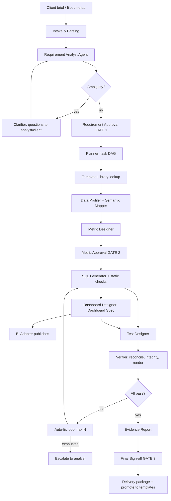

# 02 — Architecture

## High-level components
1. **Web UI** — intake, review, approvals, reports.
2. **API Gateway (FastAPI)** — auth, projects, runs, artifacts.
3. **Orchestrator** — state-machine/graph executing the agent pipeline; persists state.
4. **Agents** — Requirement Analyst, Clarifier, Planner, Data Profiler, Semantic Mapper, Metric Designer, SQL Generator, Dashboard Designer, Test Designer, Verifier, Reporter.
5. **Tool Layer** — warehouse connectors, SQL parser/linter, dry-run, BI adapters, headless browser, file parsers.
6. **Semantic Layer** — versioned YAML metric & dataset definitions (single source of truth for numbers).
7. **Template Library** — reusable metrics/layouts with vector search.
8. **Metadata Store (Postgres + pgvector)** — projects, requirements, tasks, runs, test results, embeddings.
9. **Artifact Store (Git repo + object storage)** — YAML/SQL/JSON, screenshots, reports.
10. **Observability** — traces, logs, LLM eval dashboards.

## Flow diagram

## Layered view
- **Presentation**: UI, API
- **Orchestration**: workflow engine, job queue, state store
- **Intelligence**: agents (LLM + prompts + schemas)
- **Capabilities/Tools**: deterministic code the agents call
- **Data**: metadata DB, semantic layer, artifacts, client warehouse (read-only)

## Key design decisions
- **DD-1** Semantic layer as contract: dashboards never embed ad-hoc SQL; they reference metrics → single definition → consistent numbers.
- **DD-2** Tool-agnostic Dashboard Spec + adapters → avoid lock-in to a BI tool.
- **DD-3** Two independent computation paths for verification (SQL path vs. pandas/DuckDB reference path on sampled/aggregated extract).
- **DD-4** Agents return strict JSON (Pydantic-validated); invalid output → automatic repair → retry.
- **DD-5** Each task idempotent and keyed by content hash so reruns reuse cache.
- **DD-6** Human-in-the-loop gates implemented as workflow pause states.
